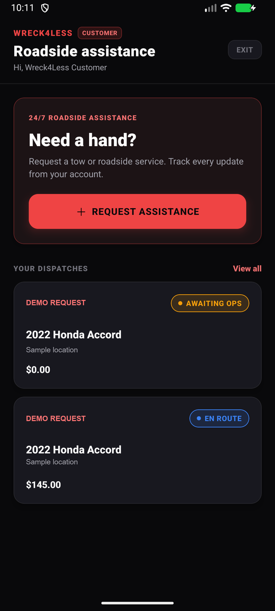
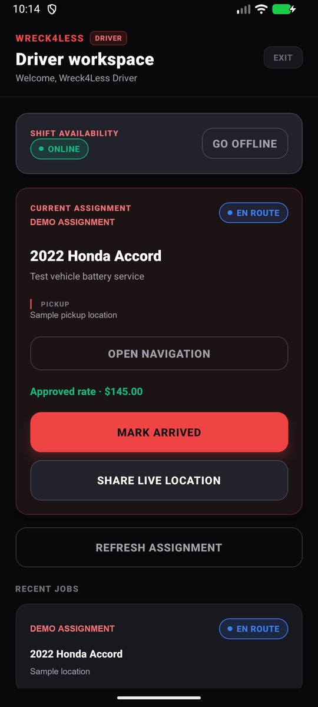
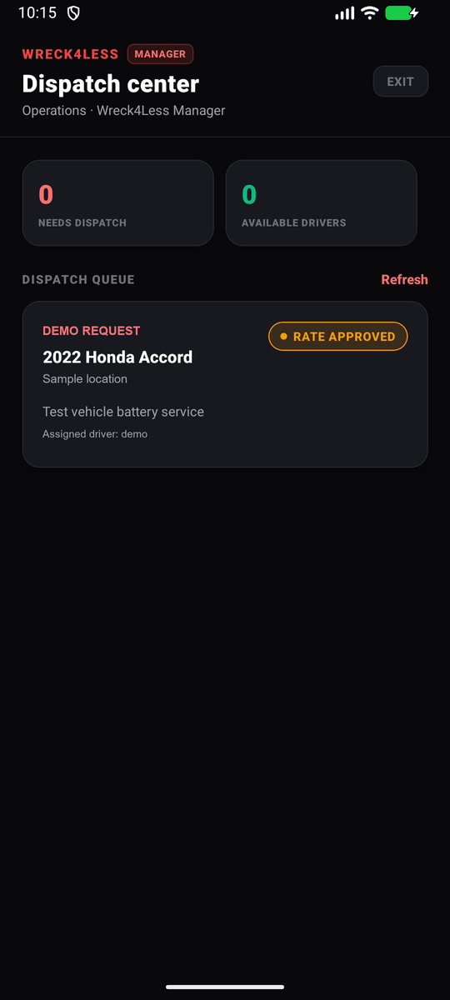
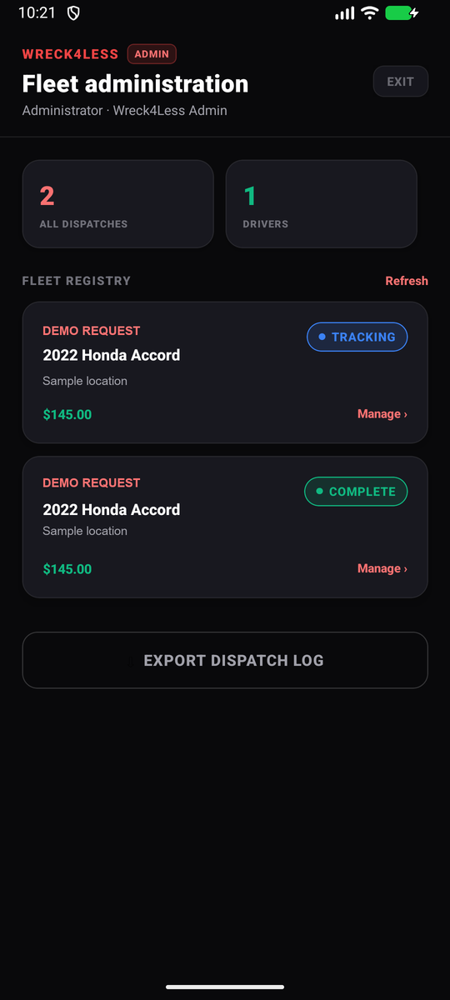

# Wreck4Less

### Roadside assistance, coordinated.

Wreck4Less is a cross-platform mobile experience for bringing customers, drivers, and operations teams together around a roadside assistance request. The product is designed to make each step easy to understand, from requesting help to dispatch coordination and service updates.

## One connected experience

- **Customers** can request roadside help, review dispatch updates, and follow service progress.
- **Drivers** can manage availability, review assignments, update job progress, and share their location while on a job.
- **Operations managers** can review requests, approve rates, and assign available drivers.
- **Fleet administrators** can oversee dispatch activity and fleet records.

The mobile app is built with React Native for iOS and Android, with dedicated workspaces for each role.

## Product screens

The gallery shows representative views from the customer, driver, manager, and administrator experiences. Sample identifiers and locations have been replaced with demo labels.

<table>
  <tr>
    <td align="center"><strong>Customer</strong> </td>
    <td align="center"><strong>Driver</strong> </td>
  </tr>
  <tr>
    <td align="center"><strong>Operations manager</strong> </td>
    <td align="center"><strong>Fleet administrator</strong> </td>
  </tr>
</table>

## Designed around the service journey

1. A customer submits a roadside assistance request.
2. Operations reviews the request and coordinates a driver.
3. The driver updates job progress and can share their location during service.
4. Customers and operations can follow the dispatch through its status changes.

## About this showcase

This repository page is a product and portfolio overview, not an end-user download or setup guide. Screenshots use illustrative sample records, not real customer data. Payment options shown in the interface are for recording a preference only; no payment is processed. Live service availability and integrations depend on the deployment.

For product discussions, evaluation, or collaboration, please reach out through the repository owner's GitHub profile.
